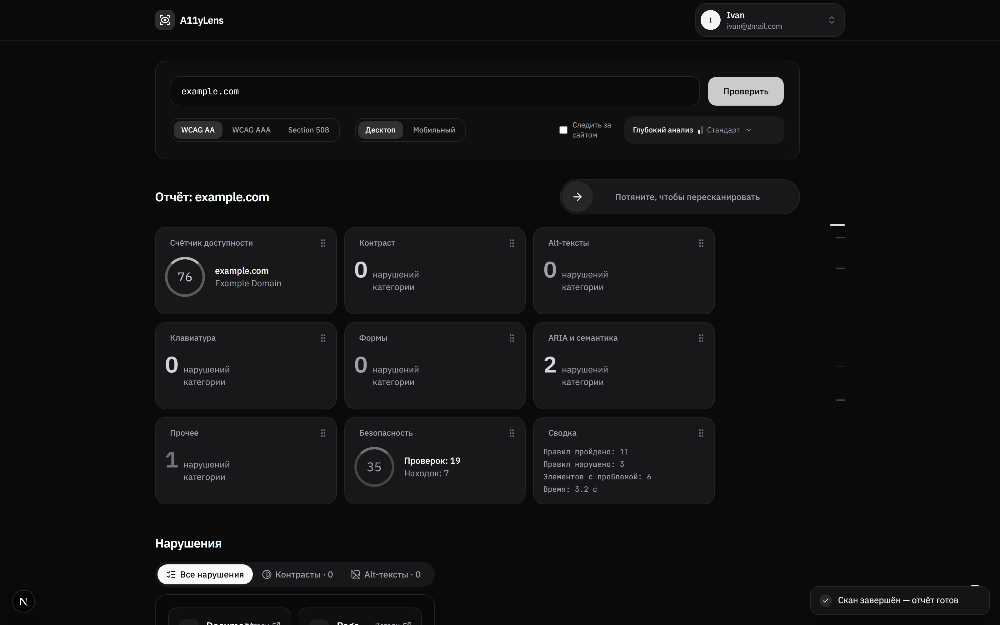
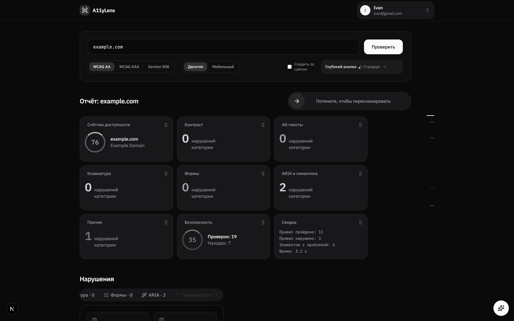
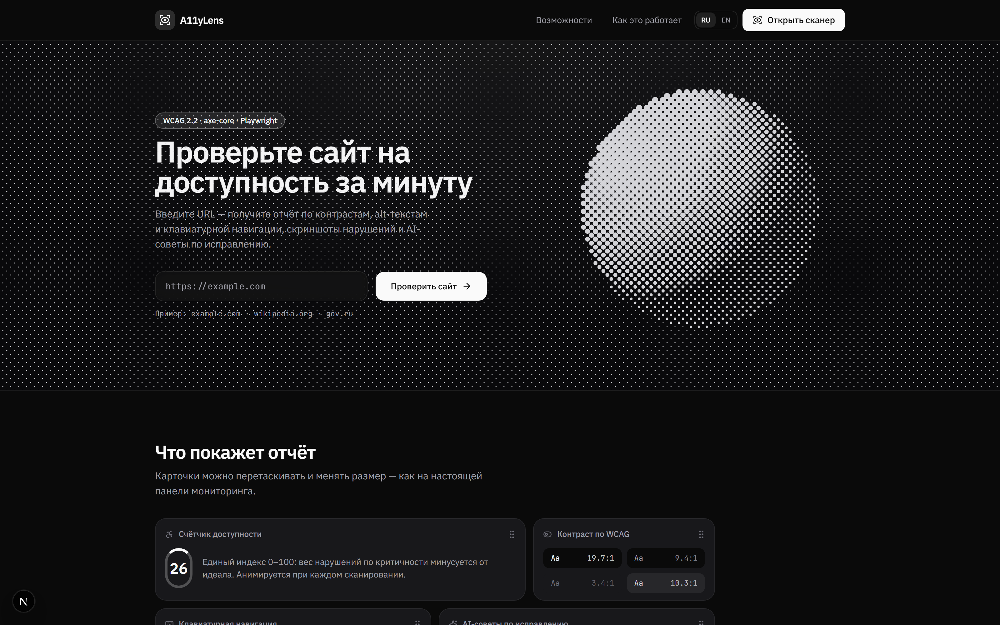
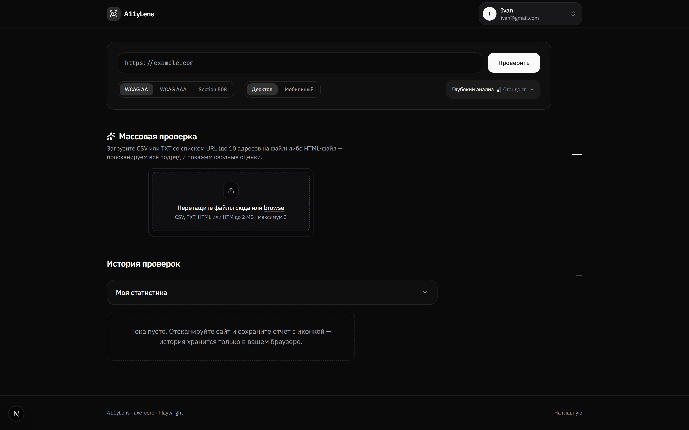
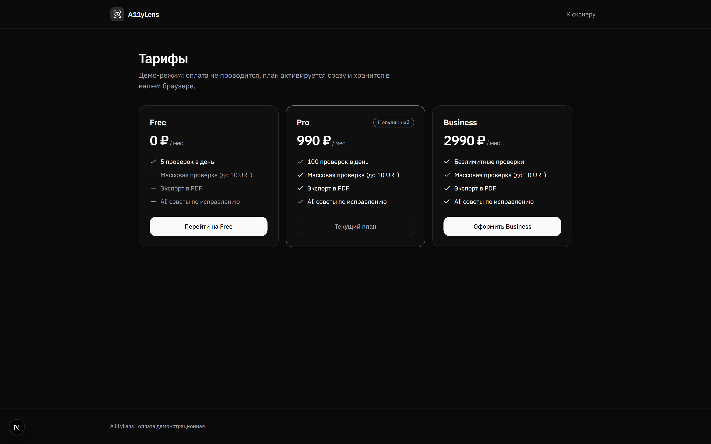
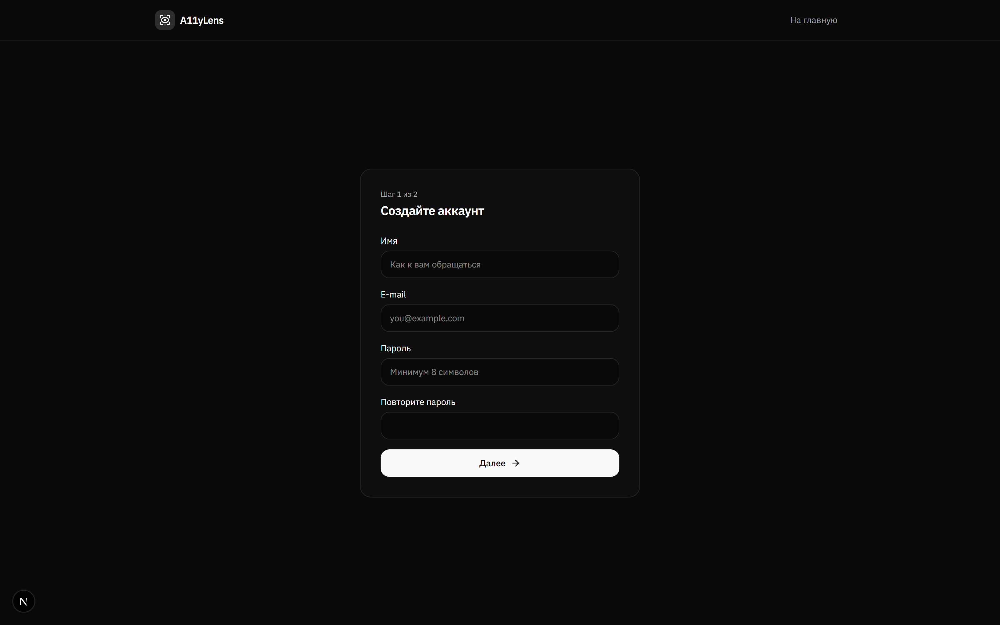
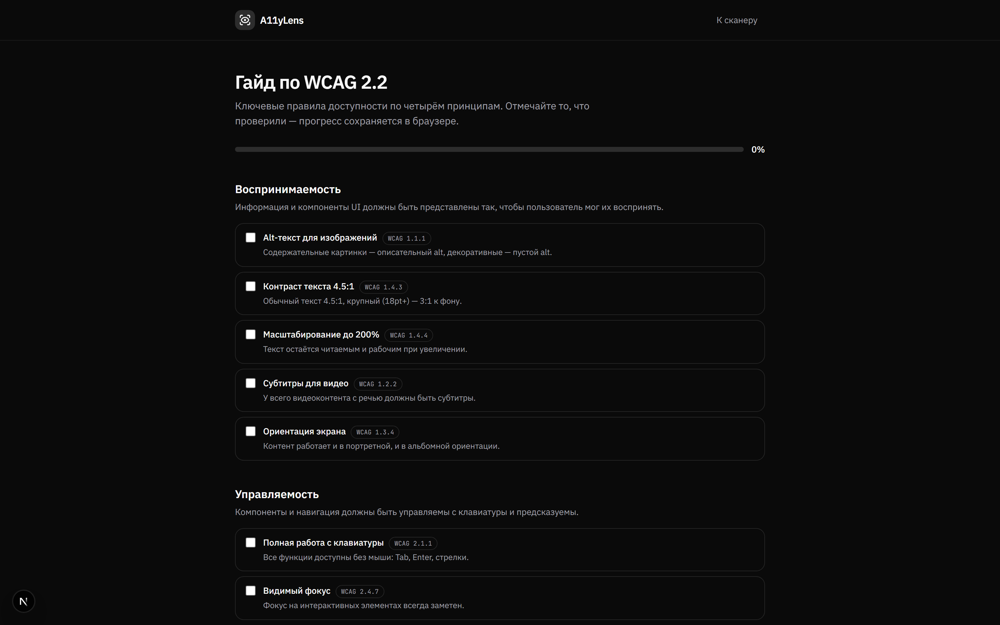

# 🔍 A11yLens

**Проверка доступности (WCAG 2.2) и кибербезопасности сайта за одну минуту.**
*Website accessibility (WCAG 2.2) & security scanner — web app, CLI and a native Windows desktop app.*

[](LICENSE)
[](#-быстрый-старт)
[](#-качество-и-тесты)
[](#-разбор-без-ии-почему-это-важно)
[](#-безопасность-и-этика-сканирования)

A11yLens открывает сайт в настоящем браузере (Playwright), прогоняет 60+ правил axe-core по стандартам WCAG 2.2 / Section 508 по нескольким страницам, аудирует заголовки безопасности, куки, mixed content и типовые утечки — и добавляет то, что браузеру недоступно: **TLS-сертификаты, открытые порты, поддомены, CVE библиотек и почтовые записи домена**. Всё собирается в один наглядный отчёт с оценками 0–100, скриншотами нарушений, **доказательством у каждой находки** и планом исправления по приоритету.

Доступен тремя способами: **веб-приложение**, **команда в терминале** (`a11ylens scan`) и **нативное Windows-приложение** — на одном и том же движке.

<p align="center">
  
</p>

---

## 🆚 Три поверхности — один движок

| | 🌐 Веб | ⌨️ CLI | 🪟 Windows |
|---|---|---|---|
| Доступность (axe-core) | ✅ | ✅ | ✅ |
| Аудит безопасности (заголовки, куки, пробы) | ✅ | ✅ | ✅ |
| Нативные проверки (TLS, порты, поддомены, CVE, почта) | — | ✅ | ✅ |
| План исправления + симуляция «если исправите» | ✅ | ✅ | ✅ |
| Экспорт | PDF / JSON / CSV | JSON / CSV | JSON |
| Нужен Node | да | ≥ 22.6 | нет (только для сборки) |
| Мультистраничный скан | до 10 страниц | до 10 (`--max-pages`) | до 10 (режим «глубоко») |

Движок живёт в `src/engine/` без Next-зависимостей — веб, CLI и десктоп считают скорости и формируют отчёт **одинаково**. Почему так — [ADR-001](docs/adr/adr-001-shared-engine.md).

---

## ✨ Возможности

### Доступность (WCAG 2.2)

- **Сканирование реальным браузером** — Playwright + axe-core: 60+ правил для WCAG AA, AAA и Section 508, десктоп и мобильные вьюпорты, обход главной и внутренних страниц (лимит настраивается).
- **Оценка 0–100** — единый индекс с весами по критичности; у каждой находки виден её вклад в балл. Формула и веса — в одном модуле (`engine/scoring.ts`), все поверхности считают идентично.
- **Скриншоты нарушений** — Playwright фотографирует каждый проблемный элемент, лайтбокс с полноэкранным просмотром.
- **Сравнение сканов (diff)** — что исправилось и что появилось с прошлого раза, дельта оценки с анимацией.
- **Мониторинг** — watchlist сайтов с баллами и индикатором ↑/↓ при рескане.
- **Экспорт** — PDF-отчёт для клиента, машинночитаемые JSON и CSV.
- **Бейдж для README** — SVG со счётчиком: `/badge?score=88&label=mysite`.

### Кибербезопасность — 26 пассивных проверок

**Браузерный аудит (20)** — доступен на всех трёх поверхностях:

| Категория | Что проверяется |
|---|---|
| Заголовки | Content-Security-Policy, HSTS, X-Frame-Options (clickjacking), X-Content-Type-Options, Referrer-Policy, Permissions-Policy, COOP |
| Cookies | Флаги Secure, HttpOnly, SameSite |
| Контент | Mixed content (HTTP-ресурсы на HTTPS-странице), SRI у внешних скриптов |
| Раскрытие | X-Powered-By, meta generator, версия jQuery (< 3.5 — известные CVE) |
| Инфраструктура | HTTP→HTTPS редирект, безопасные GET-пробы `/.git/HEAD`, `/.env`, `/phpinfo.php`, `/wp-config.php.bak`, `/.DS_Store` |

**Нативные проверки (6)** — только CLI и десктоп, без браузера (Node `tls`/`dns`/`net`):

| Проверка | Что делает |
|---|---|
| TLS-аудит | Срок и валидность сертификата (истёк / самоподписанный / имя не совпадает — high, ≤ 30 дней — warning), устаревшие протоколы TLS 1.0/1.1 |
| Порты | Топ-100 TCP-портов параллельно, таймаут 1 с; опасные (21, 23, 135, 139, 445, 3389…) — с критичностью |
| Поддомены | Пассивно через Certificate Transparency (crt.sh) + DNS-резолв, без брутфорса |
| CVE библиотек | Версии фронтенд-библиотек со страницы → бесплатный OSV API → находка с CVE-id и ссылкой |
| Почта домена | SPF / DMARC / DKIM из DNS TXT: отсутствие политик и слабые настройки — находки с рецептом |
| Технологии | Фреймворк / CMS / аналитика со страницы — инвентарь с версиями |

Каждая находка несёт **критичность** (high/medium/low/info), **доказательство** (конкретный заголовок, куки, фрагмент ответа) и **рецепт исправления**. Балл безопасности 0–100 считается рядом с оценкой доступности.

### Разбор без ИИ — почему это важно

- Для каждого правила axe и каждой проверки — словарь **«почему это проблема» человеческим языком**: кому мешает, чем грозит.
- **План исправления** — действия по убыванию эффекта на скор, с оценкой усилия (минуты / часы / дни).
- **Симуляция «если исправите»** — отметьте находки исправленными, и оба скора пересчитаются без пересканирования: видно, что починка даст.
- Объяснения **детерминированы**: одно и то же нарушение объясняется одинаково всегда — это осознанное решение против «галлюцинаций» ИИ ([ADR-002](docs/adr/adr-002-advice-without-ai.md)).

### Интерфейс

- **Темы**: тёмная / светлая / системная, акцентный цвет поверх монохрома, выбор сохраняется; контраст обеих тем проверен axe-тестом — сканер проходит по своим же правилам.
- **Bento-панель отчёта** — перетаскиваемые виджеты: счётчик, категории нарушений, сводка.
- **Command palette ⌘K**, скелетоны загрузки, уважение `prefers-reduced-motion`, непустые пустые состояния.
- **Регистрация с аватаром** (лицо генерируется процедурно), тарифы Free / Pro / Business с лимитами (демо, без реальной оплаты), чат-помощник по отчёту (rule-based), гайд по WCAG 2.2 с прогрессом, RU/EN.

<p align="center">
  
</p>

---

## 🖼 Скриншоты

| Лендинг | Сканер |
|---|---|
|  |  |

| Отчёт: доступность + безопасность | Находки безопасности |
|---|---|
|  |  |

| Тарифы | Регистрация | Гайд WCAG |
|---|---|---|
|  |  |  |

> Скриншоты сняты до введения тем и акцентного цвета — интерфейс уже ярче, чем на картинках. Переснять: `node scripts/screenshot.mjs`.

---

## 🚀 Быстрый старт

**Требования:** Node.js 18.18+ для веб-приложения; Node.js **≥ 22.6** для CLI (`a11ylens`) и сборки desktop-sidecar (движок запускает TS через type-stripping свежих Node); браузеры Playwright.

```bash
git clone https://github.com/ivan-cruzzz/A11yLens.git
cd A11yLens
npm install
npx playwright install chromium   # браузер для сканирования
npm run dev
```

Откройте [http://localhost:3000](http://localhost:3000), пройдите регистрацию и вставьте URL — отчёт готов примерно через полминуты.

> Первая проверка может занять дольше: Playwright скачивает браузер при `install`.

### Скрипты

| Команда | Что делает |
|---|---|
| `npm run dev` | Dev-сервер на :3000 |
| `npm run build` | Production-сборка (включает тайпчек) |
| `npm start` | Запуск production-сборки |
| `npm test` | Юнит-тесты (vitest): 229 тестов без доступа в сеть |
| `npm run scan:self` | Self-scan: сканер обязан найти подложенные нарушения на локальной фикстурной странице |
| `npm run cli` | CLI `a11ylens scan <url>` — полный отчёт в терминале |
| `node scripts/screenshot.mjs` | Переснять скриншоты для README |

---

## ⌨️ CLI: `a11ylens scan <url>`

Полный отчёт — доступность, безопасность и нативные проверки — прямо в терминале (Node ≥ 22.6):

```bash
npm run cli -- scan https://example.com
# или глобально:
npm link && a11ylens scan https://example.com
```

Пример вывода (сокращённо):

```
A11yLens · https://example.com

  Доступность      92/100   ██████████████░░░░
  Безопасность     88/100   ██████████████░░░░
  Нативные        100/100   ██████████████████

  ТОП-находки
  ▲ high    HSTS отсутствует — заголовок Strict-Transport-Security не найден
  ▲ medium  TLS 1.0/1.1 включены — протоколы устарели
  …

  План исправления
  1. Добавьте HSTS-заголовок        ~минуты   +8 к безопасности
  2. Отключите TLS 1.0/1.1          ~часы     +5
  …
```

**Флаги:**

| Флаг | Что делает |
|---|---|
| `--json` | Машинночитаемый JSON (полная ScanResult-модель) |
| `--csv` | Нарушения списком в CSV |
| `--security-only` | Только аудит безопасности |
| `--a11y-only` | Только доступность |
| `--max-pages N` | Лимит страниц (1–10, по умолчанию 4) |
| `--timeout ms` | Таймаут загрузки страницы |
| `--fail-under N` | Exit code 1, если скор ниже порога — для CI-гейтов |
| `--mode quick\|normal\|deep` | Интенсивность: паузы/таймауты/лимиты, не набор проверок |

**Exit codes:** `0` — скан прошёл · `1` — скор ниже `--fail-under` · `2` — ошибка (недоступный сайт, DNS/TLS-сбой, внутренний адрес).

### CI-гейт одной строкой

```yaml
# .github/workflows/audit.yml
- uses: actions/checkout@v4
- uses: actions/setup-node@v4
  with: { node-version: 22 }
- run: npm ci && npx playwright install --with-deps chromium
- run: npm run cli -- scan https://your-site.com --fail-under 85
```

Скор упал ниже 85 — пайплайн красный.

---

## 🪟 Windows-приложение (A11yLens Desktop)

Нативное окно на Tauri 2 **только для Windows** (решение автора — [ADR-003](docs/adr/adr-003-tauri-sidecar-windows-only.md)): ввод URL → прогресс по этапам → полный отчёт с локальной историей сканов.

- **Первый запуск** — экран «проверяйте только свои сайты или с разрешения» и согласие на докачку Playwright-Chromium; без согласия скан не стартует.
- **Режимы** быстро / обычно / глубоко — один конфиг с CLI: меняют паузы и лимиты, не набор проверок ([ADR-004](docs/adr/adr-004-native-checks-ethics.md)).
- **Обрыв сети не теряет работу** — попытка сохраняется с пометкой «неполный», продолжение добирает оставшиеся страницы, а не начинает с нуля.
- **На машине пользователя не нужны Node и браузеры** — движок собран в sidecar-бинарник (Node SEA). Для сборки установщика нужны Node ≥ 22.6 и Rust; конечному пользователю — чистая Windows 10+ (WebView2 докачается при необходимости).

```bat
cd desktop
npm install
npm run gen:icons
npm run build:sidecar      :: sidecar-движок a11ylens-engine.exe
npm run tauri build        :: установщики NSIS + MSI в src-tauri\target\release\bundle\
```

Подробности — [desktop/README.md](desktop/README.md).

---

## 🏗 Архитектура

```
Браузер (Next.js App Router, React 19, Tailwind 4, motion)
   │  POST /api/scan { url, standard, device, maxPages }
   ▼
API-роут → src/engine/ — общий движок без Next-зависимостей
   ├── Playwright + axe-core → нарушения доступности по страницам и тегам WCAG
   ├── пассивный аудит безопасности с доказательствами (evidence)
   ├── скоринг + план исправления + советы (rule-based, без внешнего ИИ)
   └── нативные проверки — CLI и desktop (TLS, порты, поддомены, CVE, почта)
   ▼
Отчёт: оценки, bento-панель, вкладки нарушений и находок, план исправления
Хранение: localStorage — аккаунт, план, история, watchlist, статистика
```

- **Без базы данных** — все пользовательские данные живут в `localStorage`; серверная часть stateless.
- **Один запрос — один отчёт** — доступность и безопасность собираются за один прогон; сбой аудита безопасности не ломает отчёт доступности, а виден строкой в отчёте.
- **Скоринг в одном модуле** — веса критичности и severity задаются один раз; веб, CLI и десктоп считают одинаково ([ADR-005](docs/adr/adr-005-scoring-single-source.md)).

Подробнее — [docs/architecture.md](docs/architecture.md), решения — [docs/adr/](docs/adr/).

### Структура

```
src/
├── engine/               # движок: конвейер скана, реестр проверок, нативный аудит,
│                         # скоринг (единственный источник весов), отчёт, советы
├── app/                  # маршруты: /, /scan, /register, /pricing, /guide, /badge, /api/scan
├── cli/                  # терминальный рендер и флаги CLI (bin a11ylens)
├── components/
│   ├── app/              # фичевые компоненты (отчёт, diff, темы, ⌘K, чат-помощник…)
│   └── kokonutui/        # виджеты (профиль, табы, лайтбокс, загрузка файлов…)
└── lib/                  # домен: темы, scan-diff, report-store, subscription, i18n…
tests/                    # vitest: фикстуры HTML/заголовков, моки сети, self-scan
desktop/                  # Tauri 2 Windows-приложение (см. desktop/README.md)
docs/                     # IDEAS.md — идеи развития; adr/ — почему так; architecture.md
```

---

## 🔒 Безопасность и этика сканирования

- Все проверки **пассивные**: чтение заголовков и разметки, безопасные GET-пробы типовых чувствительных путей, лёгкий скан топ-100 портов с таймаутом 1 с. Никаких эксплойтов, брутфорса и нагрузочных проб.
- Пробы подтверждаются **содержимым** ответа, а не только статусом — чтобы не ловить SPA-фолбэки на 200; редиректы проб не выполняются (защита от увода пробы на внутренние адреса).
- **SSRF-фильтр**: сканирование localhost, частных сетей, link-local (169.254.*, включая облачные метаданные), десятичных/восьмеричных IP — запрещено во всех поверхностях.
- Внешние вызовы — только **бесплатные сервисы без ключей** (OSV, crt.sh). Никаких платных API и телеметрии.
- Режимы интенсивности ограничивают скорость запросов к сканируемому сайту — по умолчанию скан деликатен.
- Это **первичный аудит**, а не замена полноценного пентеста.

## 🧪 Качество и тесты

- **`npm test`** — 229 юнит-тестов на vitest: security-проверки на HTML/заголовочных фикстурах (позитив + негатив на каждую проверку), нативный аудит на моках сокета и DNS, скоринг, советы, scan-diff, SSRF-фильтр (включая обходы), CLI-рендер и флаги, контраст тем. Тесты не ходят в сеть.
- **`npm run scan:self`** — smoke: сканер обязан найти подложенные нарушения на локальной фикстурной странице.
- Один файл: `npx vitest run tests/security.test.ts`. Desktop: свой набор из 34 тестов (`cd desktop && npm test`).
- Для сканов и контраст-тестов нужен браузер: `npx playwright install chromium`.

## 🗺 Идеи и roadmap

Планы развития — в приоритизированном документе: **[docs/IDEAS.md](docs/IDEAS.md)** — 15 идей с оценкой усилия (S/M/L), приоритетами и обоснованием.

**Топ-3 на следующий заход:** CI-гейт `--fail-under` в пайплайн · SARIF-экспорт для GitHub Security · мониторинг по расписанию с дайджестом изменений.

## 📄 Лицензия

MIT — используйте, модифицируйте и внедряйте свободно.

---

<p align="center">
  <sub>Сделано с ♥ и вниманием к доступности · A11yLens сам проходит по своим же правилам</sub>
</p>
